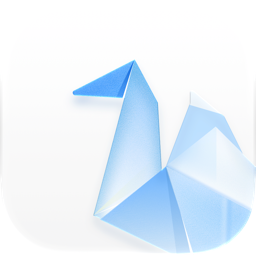

<p align="center">
  <picture>
    <source media="(prefers-color-scheme: dark)" srcset="clients/web/packages/ui/src/assets/logo-dark.png">
    
  </picture>
</p>

<h1 align="center">羽见 · OpenHane</h1>

<p align="center"><b>English</b> · <a href="docs/README.zh-CN.md">简体中文</a></p>

<p align="center">
  Self-hosted voice, video and screen sharing for your team, friends or community.<br>
  One server you own, no accounts, clients for every platform.
</p>

<p align="center">
  <a href="https://github.com/karllee830/OpenHane/releases">Download</a> ·
  <a href="https://github.com/karllee830/OpenHane/wiki/Deployment-Guide">Deployment guide</a> ·
  <a href="https://github.com/karllee830/OpenHane/wiki/Admin-Guide">Admin guide</a> ·
  <a href="https://github.com/karllee830/OpenHane/wiki/FAQ">FAQ</a>
</p>

## Why OpenHane

- **Your own server, in minutes**: one Docker container, one data volume and one port. No external database, no cloud account.
- **No sign-up**: pick a nickname and connect. Your identity is a key generated on your device, and admins hand out roles with privilege tokens.
- **Screen sharing that stays readable**: resolution, frame rate and bitrate adapt to what you share, so documents and code stay sharp and videos and games stay smooth.
- **AI noise suppression**: keyboard clicks, barking dogs and background voices are removed on your own device (DeepFilterNet3).
- **End-to-end encryption**: optional per room, or required server-wide. Compare safety codes to make sure nobody was secretly added.
- **Rooms and moderation**: a main room plus temporary rooms with passwords and locks; moderators can mute, move, kick and ban, and every admin action is logged.
- **Light on resources**: a single Go binary with a built-in media server. Voice for 20 people needs about 3 Mbps of upload bandwidth.

## Downloads

| Platform | How to get it |
|---|---|
| macOS | `.dmg` from [Releases](https://github.com/karllee830/OpenHane/releases) |
| iPhone / iPad | `.ipa` from [Releases](https://github.com/karllee830/OpenHane/releases); TestFlight and the App Store are coming soon |
| Windows | `OpenHane-Setup-*.exe` from [Releases](https://github.com/karllee830/OpenHane/releases) |
| Linux | `.AppImage` or `.deb` from [Releases](https://github.com/karllee830/OpenHane/releases) |
| Android | Coming soon |
| Browser | Open your server's address, e.g. `https://meet.example.com` (Chrome, Edge, Safari, Firefox) |

## Run a server

```bash
docker run -d --name openhane --restart unless-stopped \
  -p 9800:9800/tcp -p 9800:9800/udp -p 9801:9801/tcp \
  -v openhane-data:/data ghcr.io/karllee830/openhane-server:beta
```

The same image is also on Docker Hub as `karllee830/openhane-server`.

Then:

1. Open ports **9800/tcp**, **9800/udp** and (recommended) **9801/tcp** in your firewall or cloud security group.
2. Run `docker logs openhane` and copy the **admin privilege token** (`HANE-XXXX-…`) from the startup banner.
3. Connect with any client, then redeem the token under **More → Use privilege token** to become the admin.

On Linux, docker compose with host networking is recommended ([`deploy/`](deploy/)). Standalone binaries for running without Docker are on the [Releases](https://github.com/karllee830/OpenHane/releases) page. See the [deployment guide](https://github.com/karllee830/OpenHane/wiki/Deployment-Guide) for certificates, reverse proxies, backups, upgrades and every configuration option.

## Documentation

- [Deployment guide](https://github.com/karllee830/OpenHane/wiki/Deployment-Guide): installing, networking, certificates, backups, monitoring
- [Admin guide](https://github.com/karllee830/OpenHane/wiki/Admin-Guide): roles, privilege tokens, rooms, moderation, bans, invites, settings
- [FAQ](https://github.com/karllee830/OpenHane/wiki/FAQ): connection, audio, screen sharing and privacy questions
- [Security policy](.github/SECURITY.md): how to report a vulnerability
- [Releases](https://github.com/karllee830/OpenHane/releases): what's new in each version

## Contributing

Issues and pull requests are welcome. Your first pull request requires agreeing to the [Contributor Agreement](https://gist.github.com/karllee830/5236f985bd1cb302d51bd506c5e91b80): tick the checkbox in the pull request description; you only need to agree once.

To build from source you need Go 1.26 and Node 22 or later:

```bash
cd server && make test && make run
```

```bash
cd clients/web && npm install && npm test
```

The Apple clients are in [`clients/apple/`](clients/apple/), and the AI noise suppression library in [`clients/deepfilter/`](clients/deepfilter/) (needs [Rust](https://rustup.rs)).

## Credits

- Logo designed by [Kubai087](https://github.com/Kubai087)
- [LiveKit](https://github.com/livekit)
- [DeepFilterNet](https://github.com/Rikorose/DeepFilterNet) by Hendrik Schröter
- [RNNoise](https://github.com/xiph/rnnoise)

Third-party components are used under their own licenses.

## License

Copyright (C) 2026 Karl Lee ([karllee830](https://github.com/karllee830))

OpenHane is free software licensed under the [GNU AGPL-3.0](LICENSE).

The names "羽见" and "OpenHane" and the paper crane logo are **not covered by the AGPL-3.0; all rights are reserved**. Unmodified official releases may be redistributed as is, but modified versions must use a different name and logo. See the [name and logo notice](TRADEMARKS.md).
